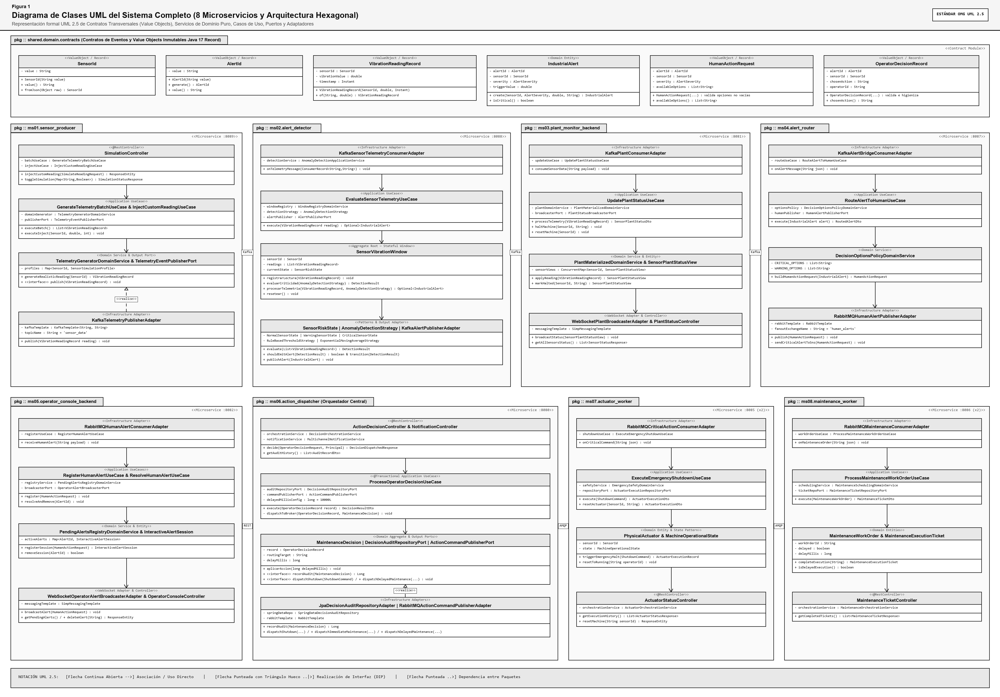
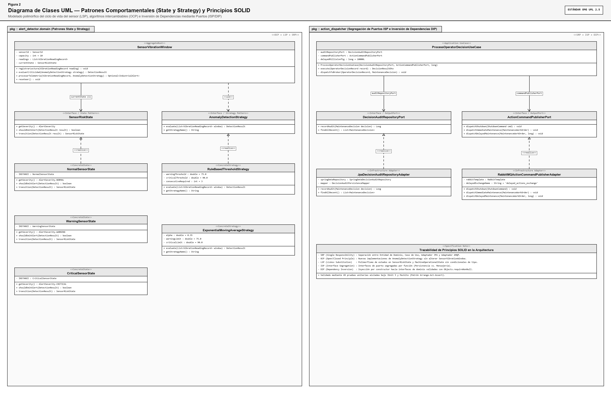
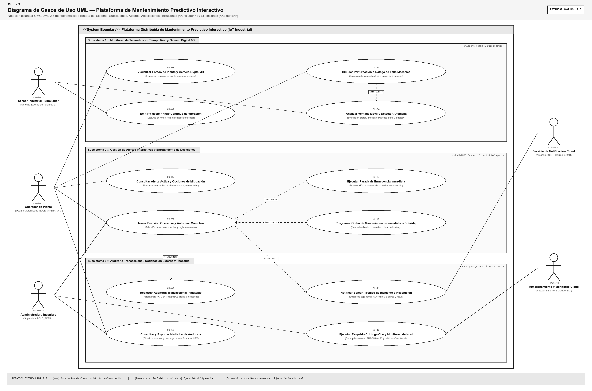
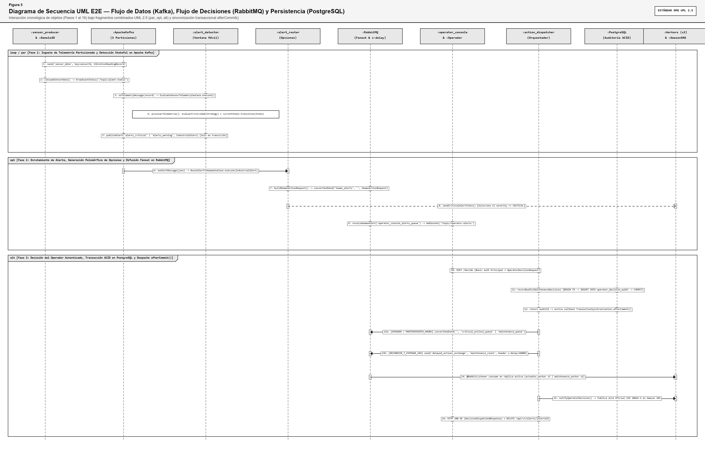
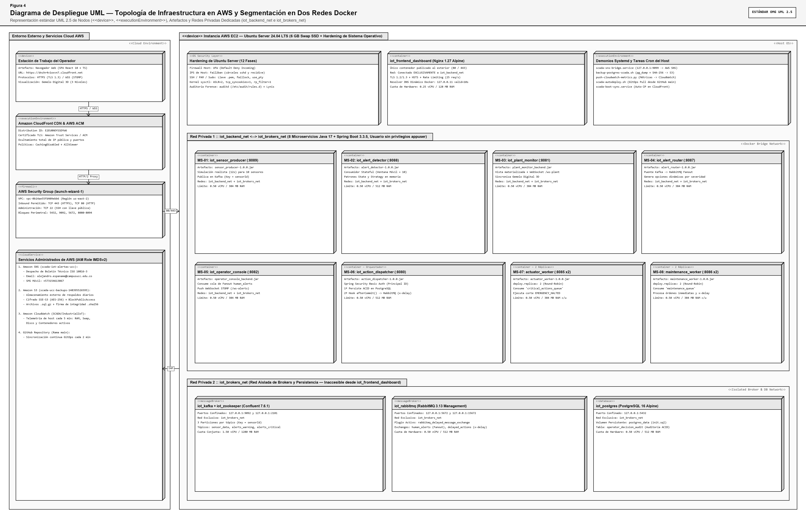

# Diseño e Implementación de una Plataforma Distribuida de Mantenimiento Predictivo Interactivo para IoT Industrial Basada en Arquitectura Hexagonal, Apache Kafka, RabbitMQ, PostgreSQL y Despliegue Seguro en AWS

**Autor:** Alejandro España  
**Facultad:** Facultad de Ingeniería — Programa de Ingeniería de Software  
**Institución:** Universidad Cooperativa de Colombia (UCC)  
**Asignaturas Integradas:** Programación Orientada a Objetos Avanzada, Sistemas Distribuidos y Sistemas Operativos  
**Infraestructura de Despliegue:** Amazon Web Services (`https://dnzhr4v1oxvn7.cloudfront.net`)  
**Fecha:** Noviembre de 2026  

---

## Resumen

El presente informe técnico documenta el diseño arquitectónico, la implementación orientada a objetos, el aseguramiento del sistema operativo y el despliegue en la nube de una **Plataforma Distribuida de Mantenimiento Predictivo Interactivo para el Internet de las Cosas Industrial (IIoT)**. El sistema aborda la problemática del monitoreo continuo de vibraciones mecánicas bajo la norma internacional **ISO 10816-3** mediante una arquitectura híbrida orientada a eventos que desacopla el *plano de ingesta masiva de datos* (**Apache Kafka**), el *plano de enrutamiento de decisiones humanas y tareas diferidas* (**RabbitMQ** con el plugin `rabbitmq_delayed_message_exchange`) y el *plano de persistencia transaccional y auditoría inmutable* (**PostgreSQL 16**). El backend se compone de ocho microservicios desarrollados en **Java 17 (JDK 17)** y **Spring Boot 3.3.5**, estructurados bajo una **Arquitectura Hexagonal (Puertos y Adaptadores)** con un **Modelo de Dominio Rico y Puro**, objetos de valor inmutables (`record`) con validación *Fail-Fast*, los patrones de diseño comportamentales **State** y **Strategy**, y el cumplimiento riguroso de los cinco principios **SOLID**. La interfaz de operación incorpora un **Gemelo Digital 3D interactivo** construido en **React 18 y TypeScript**. Finalmente, la solución fue desplegada en **Amazon Web Services (AWS EC2)** sobre **Ubuntu Server 24.04 LTS**, aplicando doce fases de endurecimiento (*Hardening*) de sistemas operativos, segmentación en dos redes virtuales privadas de Docker (`iot_backend_net` e `iot_brokers_net`), distribución de borde mediante **Amazon CloudFront** con cifrado TLS 1.3 nativo, notificación de boletines técnicos por **Amazon SNS**, respaldos criptográficos firmados con **SHA-256** en **Amazon S3** y despliegue continuo automatizado (**GitOps**).

**Palabras clave:** arquitectura hexagonal, internet de las cosas industrial, mantenimiento predictivo, Apache Kafka, RabbitMQ, patrones de diseño, hardening de Linux, Amazon Web Services.

---

## Abstract

This technical report documents the architectural design, object-oriented implementation, operating system hardening, and cloud deployment of an **Interactive Distributed Predictive Maintenance Platform for the Industrial Internet of Things (IIoT)**. The system addresses real-time mechanical vibration monitoring under the **ISO 10816-3** standard through a hybrid event-driven architecture that decouples the *high-throughput telemetry data plane* (**Apache Kafka**), the *human decision-making and delayed task routing plane* (**RabbitMQ** with `rabbitmq_delayed_message_exchange`), and the *ACID transactional audit persistence plane* (**PostgreSQL 16**). The backend comprises eight microservices built with **Java 17** and **Spring Boot 3.3.5**, structured under a **Hexagonal Architecture (Ports and Adapters)** featuring a **Pure Rich Domain Model**, immutable `record` Value Objects with *Fail-Fast* compact constructors, behavioral design patterns (**State** and **Strategy**), and strict adherence to **SOLID** principles. The operator console features an interactive **3D Building Digital Twin** built with **React 18 and TypeScript**. Finally, the platform is deployed on **AWS EC2 (Ubuntu Server 24.04 LTS)** with twelve layers of OS hardening, dual Docker private network segmentation (`iot_backend_net` and `iot_brokers_net`), **Amazon CloudFront** edge TLS delivery, **Amazon SNS** corporate notifications, **SHA-256** signed backups replicated to **Amazon S3**, and automated **GitOps** continuous deployment.

**Keywords:** hexagonal architecture, industrial IoT, predictive maintenance, Apache Kafka, RabbitMQ, design patterns, Linux hardening, Amazon Web Services.

---

## 1. Introducción y Planteamiento del Problema

En las plantas industriales modernas, la falla inesperada de activos rotativos críticos —tales como turbinas, generadores síncronos, compresores centrífugos y bombas hidráulicas— produce paradas no planificadas de alto costo económico y riesgo operativo. El monitoreo de condición basado en vibraciones mecánicas (medidas en velocidad eficaz $\text{mm/s RMS}$ conforme al estándar **ISO 10816-3**) exige procesar flujos continuos de telemetría en tiempo real, identificar anomalías mediante ventanas deslizantes con estado (*stateful sliding windows*) y coordinar la intervención oportuna de operadores humanos junto con actuadores automatizados.

Sin embargo, el diseño de este tipo de plataformas enfrenta cuatro desafíos fundamentales de ingeniería de software y sistemas distribuidos:

1. **Incompatibilidad entre ingesta masiva y enrutamiento complejo:** Un único bróker de mensajería rara vez es óptimo tanto para almacenar millones de eventos ordenados por partición como para gestionar colas de trabajo con retardos temporales por mensaje (*per-message TTL / delay*) y enrutamiento condicional.
2. **Tormentas de alertas (*Alert Storms*):** Los sistemas que evalúan umbrales de manera *stateless* (sin memoria de estado) emiten una nueva alerta en cada lectura consecutiva que supera el umbral, saturando las consolas humanas y los canales de correo electrónico.
3. **Inconsistencia transaccional entre base de datos y mensajería:** Si un microservicio publica una orden de apagado en el bróker de mensajería antes de confirmar (*commit*) la transacción de auditoría en la base de datos relacional, un fallo de persistencia deja acciones físicas ejecutadas en planta sin rastro forense.
4. **Exposición de superficie de ataque en despliegues contenedorizados:** Por defecto, el motor Docker manipula directamente las cadenas `PREROUTING` y `DOCKER` de `iptables`/`nftables`, exponiendo puertos críticos de bases de datos y brókers a Internet aun cuando el firewall del sistema operativo (`UFW`) esté activo.

Para resolver integralmente estos cuatro desafíos, se diseñó, implementó y desplegó una plataforma distribuida compuesta por **15 contenedores gobernados** en **AWS EC2**, integrando **Apache Kafka**, **RabbitMQ**, **PostgreSQL 16**, **8 microservicios en Java 17 + Spring Boot 3.3.5**, un **Gemelo Digital 3D en React + TypeScript** y un esquema de **Defensa en Profundidad** a nivel de sistema operativo y nube.

---

## 2. Marco Arquitectónico: Diseño Híbrido de Mensajería y Persistencia

Siguiendo los principios de diseño de sistemas intensivos en datos expuestos por Kleppmann (2017), la arquitectura separa estrictamente tres responsabilidades mediante tecnologías especializadas:

### 2.1. El Flujo de Datos Masivos: Apache Kafka (Procesamiento Stateful y Particionamiento)

**Apache Kafka** opera como un registro distribuido de solo adición (*append-only commit log*) particionado. En la plataforma se definieron tres tópicos con **3 particiones** cada uno (`KAFKA_NUM_PARTITIONS: 3`): `sensor_data`, `alerts_warning` y `alerts_critical`.

Para garantizar que las lecturas de un sensor específico nunca se procesen fuera de orden cronológico, el microservicio productor (`sensor_producer`) asigna el identificador único del sensor (`SensorId`, por ejemplo `"sensor_A"`) como **clave de partición (*Partition Key*)**:

$$\text{Partición Destino} = \text{murmur2}(\text{sensorId}) \pmod{3}$$

De esta forma, todas las lecturas de `"sensor_A"` son dirigidas determinísticamente a la misma partición y consumidas en orden estricto por una única hebra del grupo consumidor `alert-detector-group`, permitiendo mantener en memoria una ventana móvil exacta de las últimas $N = 10$ lecturas sin condiciones de carrera entre nodos.

### 2.2. El Flujo de Decisiones Humanas y Tareas Diferidas: RabbitMQ (Protocolo AMQP 0-9-1)

Una vez que el motor analítico detecta una transición hacia un estado de riesgo, el flujo pasa del plano de datos al plano de decisiones gobernado por **RabbitMQ 3.13**. A diferencia de Kafka, en RabbitMQ el productor nunca escribe directamente en una cola, sino que publica el mensaje en un **Exchange (Intercambiador)**, el cual evalúa reglas de enlace (*Bindings*) y claves de enrutamiento (*Routing Keys*). Se implementaron tres tipos de *Exchange*:

1. **`FanoutExchange` (`human_alerts`):** Difunde en modo *broadcast* toda alerta enriquecida con opciones hacia la cola `operator_console_alerts_queue` consumida por la consola interactiva del operador.
2. **`Direct Exchange` (Intercambiador directo por defecto `""`):** Enruta de forma inmediata las órdenes críticas de corte de energía hacia `critical_actions_queue` (consumida por las réplicas de `actuator_worker`) y las órdenes de mantenimiento inmediato hacia `maintenance_queue` (consumida por las réplicas de `maintenance_worker`).
3. **`CustomExchange` de tipo `x-delayed-message` (`delayed_actions_exchange`):** Habilitado mediante el plugin oficial `rabbitmq_delayed_message_exchange`. Cuando el operador selecciona la opción `RECONOCER_Y_ESPERAR_24H`, el mensaje se publica con la cabecera AMQP `x-delay: 10000` (10 segundos que simulan las 24 horas en entorno de demostración). El *Exchange* retiene el mensaje en el almacenamiento interno del bróker y, al expirar el temporizador, lo transfiere automáticamente a `maintenance_queue` mediante la clave `maintenance_route`.

### 2.3. Persistencia Transaccional y Sincronización Post-Commit: PostgreSQL 16

El motor relacional **PostgreSQL 16** almacena de forma inmutable todas las resoluciones humanas en la tabla `operator_decision_audit`. Para evitar que un comando sea enviado a RabbitMQ si la transacción SQL falla, el caso de uso `ProcessOperatorDecisionUseCase` registra un gancho transaccional mediante `TransactionSynchronizationManager.registerSynchronization(...)`. Así, la publicación AMQP y la notificación hacia **Amazon SNS** se ejecutan exclusivamente dentro del método `afterCommit()`, garantizando consistencia transaccional de extremo a extremo.

---

## 3. Arquitectura de Software, Programación Orientada a Objetos Avanzada y Principios SOLID

### 3.1. Arquitectura Hexagonal (Puertos y Adaptadores)

Conforme al patrón formulado por Cockburn (2005) y los principios de *Clean Architecture* (Martin, 2017), cada uno de los ocho microservicios está estructurado de manera uniforme en cuatro capas concéntricas:

* **Capa de Dominio (`domain.model`, `domain.service`, `domain.repository`, `domain.exception`):** Contiene las entidades ricas, agregados, objetos de valor (`record`), máquinas de estado, estrategias matemáticas e interfaces de puerto (`*Port`). Esta capa es **100% Java puro**, careciendo por completo de anotaciones o importaciones de Spring Framework (`@Service`, `@Component`, `@Autowired`), JPA o clientes de mensajería.
* **Capa de Aplicación (`application.usecase`, `application.service`, `application.dto`):** Orquesta los casos de uso del negocio invocando entidades de dominio y comunicándose con el exterior exclusivamente a través de las interfaces de puerto definidas en el dominio.
* **Capa de Infraestructura (`infrastructure.adapter`, `infrastructure.persistence`, `config`):** Implementa los adaptadores concretos de Kafka (`@KafkaListener`, `KafkaTemplate`), RabbitMQ (`@RabbitListener`, `RabbitTemplate`), PostgreSQL (`SpringDataDecisionAuditRepository`), WebSockets STOMP (`SimpMessagingTemplate`), Amazon SNS (`HttpClient`) y la configuración de beans (`BeanConfig`).
* **Capa de Presentación (`presentation.controller`, `presentation.request`, `presentation.response`, `presentation.mapper`):** Expone los controladores REST (`@RestController`), validaciones de entrada y manejadores globales de excepciones (`@RestControllerAdvice`).

En la **Figura 1** se presenta el Diagrama de Clases UML del sistema completo, evidenciando la relación entre el módulo transversal de contratos y los ocho microservicios.



*Nota.* La Figura 1 muestra la estructura de paquetes y clases de los 8 microservicios (`ms01` a `ms08`) y el paquete superior de contratos y *Value Objects* compartidos bajo notación estándar OMG UML 2.5.

---

### 3.2. Modelo de Dominio Rico vs. Modelo Anémico e Inmutabilidad con Java 17 `record`

Se erradicó el antipatrón de *Modelo de Dominio Anémico* (Fowler, 2002) suprimiendo los métodos `set*` públicos en las entidades de negocio y encapsulando las reglas e invariantes dentro de métodos semánticos:

* En `SensorVibrationWindow` (`alert_detector`): El estado interno de la ventana deslizante (`List<VibrationReadingRecord>`) está protegido y solo puede modificarse mediante `registrarLectura(reading)`, `evaluarCriticidad(strategy)`, `procesarTelemetria(reading, strategy)` y `resetear()`, mientras que `getVentanaHistorica()` retorna una vista inmodificable (`Collections.unmodifiableList(...)`).
* En `MaintenanceDecision` (`action_dispatcher`): El método de negocio `aplicarAccion(long delayedMillisConfig)` evalúa la semántica de la decisión del operador y determina internamente el destino de enrutamiento (`critical_actions_queue`, `maintenance_queue`, `delayed_actions_exchange` o `NONE_IGNORED`) y el tiempo de retardo aplicable.

Adicionalmente, todos los identificadores y eventos de red se implementaron como **Value Objects inmutables** utilizando `record` de **Java 17** con **validaciones *Fail-Fast* en sus constructores compactos**:

* **`VibrationReadingRecord`:** Valida en su constructor compacto que `sensorId` y `timestamp` no sean nulos, que `vibrationValue` no sea `NaN` ni infinito (`Double.isNaN` / `Double.isInfinite`) y que se encuentre dentro del rango físico admisible $[0.0, 500.0]\text{ mm/s}$.
* **`SensorId` y `AlertId`:** Validan que el identificador no sea nulo ni cadena vacía tras aplicar `.trim()`, e incorporan las anotaciones `@JsonValue` y `@JsonCreator` para garantizar una serialización JSON plana (`"sensor_A"`) entre backend y frontend.
* **`HumanActionRequest` y `OperatorDecisionRecord`:** Validan la presencia obligatoria de todos sus atributos, verifican que la lista de opciones de mitigación no esté vacía y crean copias defensivas inmutables (`List.copyOf(...)`).

---

### 3.3. Patrones de Diseño Comportamentales (`State` y `Strategy`) y Principios SOLID

Siguiendo el catálogo clásico de Gamma et al. (1994), en el microservicio `alert_detector` se combinaron dos patrones comportamentales para eliminar condicionales complejos anidados y erradicar las tormentas de alertas:

1. **Patrón Strategy (`AnomalyDetectionStrategy`):** Define una familia de algoritmos matemáticos intercambiables para evaluar la ventana móvil de lecturas:
   * `RuleBasedThresholdStrategy`: Evalúa las dos reglas del caso de estudio basadas en la norma ISO 10816-3 (Regla 1: Crítica inmediata si la última lectura supera $90.0\text{ mm/s}$; Regla 2: Advertencia si las últimas 3 lecturas consecutivas superan $75.0\text{ mm/s}$).
   * `ExponentialMovingAverageStrategy`: Calcula la media móvil exponencial ponderada ($\text{EMA}_t = \alpha X_t + (1 - \alpha)\text{EMA}_{t-1}$ con $\alpha = 0.35$) para detectar tendencias sostenidas de degradación.
2. **Patrón State (`SensorRiskState`):** Modela de forma polimórfica los estados de riesgo del sensor a través de las clases `NormalSensorState`, `WarningSensorState` y `CriticalSensorState` (y de forma análoga `MachineOperationalState` con `RunningMachineState` y `EmergencyHaltedMachineState` en `actuator_worker`). El método `currentState.shouldEmitAlert(result)` retorna `true` **únicamente cuando ocurre una transición real hacia un estado de mayor criticidad** (por ejemplo, de `NORMAL` a `WARNING` o de `WARNING` a `CRITICAL`), suprimiendo emisiones redundantes mientras el sensor permanezca en el mismo estado.

En la **Figura 2** se detalla el acoplamiento polimórfico de los patrones `State` y `Strategy` junto con la inversión de dependencias en `action_dispatcher`.



*Nota.* La Figura 2 ilustra la aplicación conjunta de los patrones *State* y *Strategy* en `alert_detector` (izquierda) y la segregación e inversión de puertos en `action_dispatcher` (derecha).

En la **Tabla 1** se sintetiza la aplicación verificable de los cinco principios **SOLID** (Martin, 2017) en el código fuente del proyecto.

**Tabla 1**  
*Matriz de Implementación de los Cinco Principios SOLID en los Microservicios Backend*

| Principio SOLID | Mecanismo Técnico Aplicado | Clases y Archivos de Evidencia en el Proyecto |
| :--- | :--- | :--- |
| **S — Single Responsibility Principle (SRP)** | Separación estricta de responsabilidades: las entidades validan reglas de negocio, los casos de uso coordinan transacciones, los adaptadores JPA persisten en SQL y los adaptadores AMQP/SNS publican mensajes. | `MaintenanceDecision.java`, `ProcessOperatorDecisionUseCase.java`, `JpaDecisionAuditRepositoryAdapter.java`, `RabbitMQActionCommandPublisherAdapter.java`, `MultichannelNotificationService.java` |
| **O — Open/Closed Principle (OCP)** | El agregado `SensorVibrationWindow` está abierto a la extensión de nuevos algoritmos matemáticos de detección mediante la interfaz `AnomalyDetectionStrategy`, pero cerrado a la modificación de su código. | `AnomalyDetectionStrategy.java`, `RuleBasedThresholdStrategy.java`, `ExponentialMovingAverageStrategy.java`, `SensorVibrationWindow.java` |
| **L — Liskov Substitution Principle (LSP)** | Polimorfismo puro en las máquinas de estado del sensor y del actuador: el contexto delega en `SensorRiskState` y `MachineOperationalState` sin utilizar verificaciones de tipo (`instanceof`) ni conversiones forzadas (*castings*). | `SensorRiskState.java`, `NormalSensorState.java`, `WarningSensorState.java`, `CriticalSensorState.java`, `MachineOperationalState.java` |
| **I — Interface Segregation Principle (ISP)** | Segregación de puertos de salida granulares en lugar de interfaces monolíticas: el puerto de persistencia SQL está separado del puerto de despacho AMQP, de modo que las consultas de auditoría no dependen de RabbitMQ. | `DecisionAuditRepositoryPort.java`, `ActionCommandPublisherPort.java`, `GetDecisionAuditHistoryUseCase.java` |
| **D — Dependency Inversion Principle (DIP)** | Los casos de uso de alto nivel dependen exclusivamente de interfaces de puerto (`*Port`) ubicadas en el dominio, inyectadas por constructor con validación explícita `Objects.requireNonNull(...)` y cero uso de `@Autowired` en atributos. | `EvaluateSensorTelemetryUseCase.java`, `RouteAlertToHumanUseCase.java`, `ProcessOperatorDecisionUseCase.java`, `ExecuteEmergencyShutdownUseCase.java` |

*Nota.* Elaboración propia a partir de la estructura del repositorio de código fuente.

---

## 4. Especificación Funcional, Microservicios, Casos de Uso y Procesos

### 4.1. Catálogo y Responsabilidades de los Microservicios

En la **Tabla 2** se describe la función arquitectónica, los puertos internos, las entradas/salidas y las cuotas de hardware asignadas a cada componente contenedorizado.

**Tabla 2**  
*Especificación Técnica de los Microservicios y Componentes del Sistema Distribuido*

| Componente / Microservicio | Tecnología Base | Rol Arquitectónico y Lógica de Negocio | Entradas y Salidas de Red / Mensajería | Cuota CPU / RAM (Réplicas) |
| :--- | :--- | :--- | :--- | :--- |
| **`sensor_producer`** | Java 17 / Spring Boot | Simula los 10 sensores de los 3 niveles del edificio (`sensor_A` a `sensor_J`) con ciclo realista de 12s y permite inyectar picos (`>90`) o ráfagas (`3x >75`). | **Entrada:** REST `/api/v1/simulation/*`<br>**Salida:** Kafka `sensor_data` (`Key = sensorId`) | `0.50 vCPU` / `384 MB` (1) |
| **`alert_detector`** | Java 17 / Spring Boot | **Cerebro Analítico Stateful:** Mantiene la ventana móvil `SensorVibrationWindow` por sensor y evalúa los patrones *Strategy* y *State*. | **Entrada:** Kafka `sensor_data`<br>**Salida:** Kafka `alerts_critical` y `alerts_warning` | `0.50 vCPU` / `512 MB` (1) |
| **`plant_monitor_backend`** | Java 17 / Spring Boot | Mantiene la vista materializada en vivo de las 10 máquinas de la planta y sincroniza el **Gemelo Digital 3D** mediante WebSockets STOMP. | **Entrada:** Kafka `sensor_data`, `alerts_*`<br>**Salida:** WebSocket `/ws-plant` y REST `/api/v1/sensors/*` | `0.50 vCPU` / `384 MB` (1) |
| **`alert_router`** | Java 17 / Spring Boot | Puente híbrido Kafka $\rightarrow$ RabbitMQ. Genera polimórficamente las opciones de mitigación según la severidad de la alerta detectada. | **Entrada:** Kafka `alerts_critical`, `alerts_warning`<br>**Salida:** RabbitMQ Fanout `human_alerts` + AWS SNS | `0.50 vCPU` / `384 MB` (1) |
| **`operator_console_backend`** | Java 17 / Spring Boot | Gestiona las sesiones de alertas activas pendientes de decisión humana y las transmite en tiempo real a la consola del operador. | **Entrada:** RabbitMQ `operator_console_alerts_queue`<br>**Salida:** WebSocket `/ws-alerts` y REST `/api/v1/alerts/*` | `0.50 vCPU` / `384 MB` (1) |
| **`action_dispatcher`** | Java 17 / Spring Boot | **Orquestador Central / Padre:** Autentica al operador con Spring Security, persiste la auditoría ACID en PostgreSQL y despacha `afterCommit()`. | **Entrada:** REST `POST /decide` (Basic Auth)<br>**Salida:** PostgreSQL + RabbitMQ Direct/Delayed + AWS SNS | `0.50 vCPU` / `512 MB` (1) |
| **`actuator_worker`** | Java 17 / Spring Boot | Worker concurrente que ejecuta comandos críticos de parada de emergencia (`EMERGENCY_HALTED`) y reactivación segura de maquinaria. | **Entrada:** RabbitMQ `critical_actions_queue`<br>**Salida:** REST `/api/v1/actuators/history` y `/reset` | `0.50 vCPU` / `384 MB` (**2 Réplicas**) |
| **`maintenance_worker`** | Java 17 / Spring Boot | Worker concurrente que procesa órdenes de trabajo de mantenimiento tanto inmediatas como diferidas liberadas tras expirar `x-delay`. | **Entrada:** RabbitMQ `maintenance_queue`<br>**Salida:** REST `/api/v1/maintenance/tickets` | `0.50 vCPU` / `384 MB` (**2 Réplicas**) |
| **`frontend_dashboard`** | React 18 / TS / Nginx 1.27 | Consola interactiva en tonos crema/marfil con **Gemelo Digital 3D del edificio** y Reverse Proxy Nginx con TLS 1.2/1.3 y DNS dinámico. | **Entrada:** HTTPS (`443`) y HTTP (`80`)<br>**Salida:** Proxy interno hacia `iot_backend_net` | `0.25 vCPU` / `128 MB` (1) |

*Nota.* Todos los contenedores de infraestructura y microservicios backend tienen sus puertos del host ligados exclusivamente a la interfaz loopback `127.0.0.1`.

---

### 4.2. Modelo de Casos de Uso del Sistema

Para facilitar la comprensión funcional del sistema tanto por perfiles técnicos como por evaluadores externos, en la **Figura 3** se presenta el Diagrama de Casos de Uso bajo notación estándar OMG UML 2.5 monocromática, estructurado en tres subsistemas: (1) Monitoreo de Telemetría y Gemelo Digital 3D, (2) Gestión de Alertas Interactivas y Enrutamiento de Decisiones, y (3) Auditoría Transaccional, Notificación Externa y Respaldo Cloud.



*Nota.* La Figura 3 representa las asociaciones entre los cinco actores del sistema y los doce casos de uso (`CU-01` a `CU-12`), diferenciando las relaciones obligatorias (`<<include>>`) de los flujos condicionales (`<<extend>>`).

---

### 4.3. Proceso y Secuencia de Operación de Punta a Punta (End-to-End)

El ciclo completo de operación desde la generación de una lectura de vibración hasta la ejecución de la acción correctiva y su notificación por correo electrónico consta de dieciséis pasos secuenciales divididos en tres fases, tal como se modela formalmente en la **Figura 5**.



*Nota.* La Figura 5 detalla los mensajes síncronos y asíncronos entre las nueve líneas de vida del sistema utilizando fragmentos combinados estándar UML 2.5 (`loop / par`, `opt` y `alt`).

---

## 5. Contenerización, Segmentación de Redes, Hardening de Linux y Despliegue en AWS

### 5.1. Dockerfiles Multietapa, Usuario No Privilegiado y Gobernanza de JVM

Cada uno de los ocho microservicios Java implementa un `Dockerfile` multietapa de dos fases:

1. **Etapa 1 (`builder` — `maven:3.9.6-eclipse-temurin-17-alpine`):** Descarga en caché las dependencias del `pom.xml` (`mvn dependency:go-offline -B`) y empaqueta el artefacto ejecutable (`mvn clean package -DskipTests`).
2. **Etapa 2 (`runtime` — `eclipse-temurin:17-jre-alpine`):** Carece de compiladores y código fuente. Crea un grupo y usuario de sistema sin privilegios (`addgroup -S appgroup && adduser -S appuser -G appgroup`), asigna la propiedad del artefacto `app.jar`, declara `USER appuser` y configura parámetros ergonómicos de memoria para la Máquina Virtual de Java sincronizados con los límites de Cgroups de Docker:
   ```dockerfile
   ENV JAVA_OPTS="-XX:+UseContainerSupport -XX:MaxRAMPercentage=75.0 -XX:+ExitOnOutOfMemoryError"
   ```

### 5.2. Segmentación en Dos Redes Privadas Dedicadas en `docker-compose.yml`

Con el fin de aplicar el principio de menor privilegio a nivel de red virtual y cumplir con el requerimiento de redes privadas dedicadas, en `docker-compose.yml` se segmentó la arquitectura en **dos redes bridge independientes**:

* **`iot_backend_net` (Red de Aplicación y Reverse Proxy):** Conecta únicamente al contenedor público `iot_frontend_dashboard` (Nginx) con los puntos de entrada HTTP/WebSocket de los microservicios Java. Ni PostgreSQL, ni Apache Kafka, ni Zookeeper, ni RabbitMQ están conectados a esta red.
* **`iot_brokers_net` (Red Aislada de Brokers y Persistencia):** Conecta exclusivamente a `iot_postgres`, `iot_kafka`, `iot_zookeeper` e `iot_rabbitmq` con los adaptadores de infraestructura de los microservicios backend. El contenedor público `iot_frontend_dashboard` **no pertenece a `iot_brokers_net`**, impidiendo físicamente cualquier intento de conexión directa desde la capa web frontal hacia los motores de datos o mensajería.

En la **Figura 4** se presenta el Diagrama de Despliegue UML completo, ilustrando la topología en AWS y la segmentación en las dos redes virtuales de Docker.



*Nota.* La Figura 4 muestra la disposición física y lógica de los nodos en AWS (`us-east-2`), incluyendo Amazon CloudFront, AWS ACM, Security Group, las capas de Hardening de Ubuntu Server 24.04 LTS y la separación entre `iot_backend_net` e `iot_brokers_net`.

---

### 5.3. Hardening de Sistemas Operativos en Ubuntu Server 24.04 LTS y Servicios Cloud AWS

Sobre la instancia **AWS EC2 (Ubuntu Server 24.04 LTS)** se desarrolló e implementó el script automatizado `aws/hardening-ubuntu.sh` estructurado en **doce fases de Defensa en Profundidad**, resumidas en la **Tabla 3**.

**Tabla 3**  
*Fases de Hardening de Sistema Operativo e Integración Cloud Aplicadas en Ubuntu Server 24.04 LTS*

| Fase | Dominio de Seguridad / Cloud | Archivos de Configuración e Implementación | Control Técnico Aplicado en el Servidor de Producción |
| :--- | :--- | :--- | :--- |
| **Fase 1** | Gestión de Parches | `/etc/apt/apt.conf.d/20auto-upgrades` | Actualizaciones automáticas de seguridad (`unattended-upgrades`) y reinicio controlado de demonios (`needrestart`). |
| **Fase 2** | Blindaje SSH, PAM y Sudo | `/etc/ssh/sshd_config.d/01-hardening.conf`, `/etc/sudoers.d/99-hardening`, `/etc/issue.net` | `PermitRootLogin no`, `PasswordAuthentication no`, autenticación exclusiva por llave `.pem`, `MaxAuthTries 3`, banner legal, `use_pty`, `pwquality` (`minlen=14`) y `faillock` (5 intentos). |
| **Fase 3** | Firewall Host e IPS | `ufw`, `/etc/fail2ban/jail.local` | Política `default deny incoming` en UFW (solo puertos 22, 80 y 443) y cárceles activas `sshd` y `recidive` en **Fail2ban** con baneo incremental hasta 1 semana. |
| **Fase 4** | Endurecimiento del Kernel | `/etc/sysctl.d/99-hardening.conf`, `/etc/modprobe.d/99-hardening.conf` | Aleatorización completa de espacio de memoria ASLR (`randomize_va_space=2`), `kptr_restrict=2`, `tcp_syncookies=1`, `rp_filter=1`, bloqueo de *Core Dumps* y módulos USB/FS obsoletos. |
| **Fase 5** | Vigilancia de Recursos | `/usr/local/sbin/check-resources.sh`, `/etc/cron.d/check-resources` | Monitoreo cada 5 minutos con `sysstat` (`mpstat`, `free`, `df`) y alerta automática en `syslog` ante umbrales $>85\%$ CPU/Disco o $>90\%$ RAM. |
| **Fase 6** | Auditoría Forense | `/etc/audit/rules.d/99-hardening.rules`, `suid_baseline.txt` | Vigilancia a nivel de kernel con **`auditd`** sobre `/etc/passwd`, `/etc/shadow`, `/etc/sudoers`, `/etc/ssh` y ejecuciones de `sudo`/`su`, complementada con auditoría **Lynis**. |
| **Fase 7** | Puente Confinado AWS SNS | `/etc/systemd/system/scada-sns-bridge.service` | Demonio local Python/Boto3 autenticado mediante **Rol IAM (`IMDSv2`)** sin credenciales en disco, confinado con `ProtectSystem=strict`, `NoNewPrivileges=true` y `MemoryMax=128M`. |
| **Fase 8** | Respaldo Criptográfico S3 | `/usr/local/sbin/backup-postgres-scada.sh`, `upload-backup-s3.py` | Volcado diario `pg_dump` comprimido (`.sql.gz`), firmado con hash **`SHA-256`** y replicado con cifrado **`AES-256`** al bucket privado `s3://scada-ucc-backups-148395526595`. |
| **Fase 9** | Telemetría CloudWatch | `/usr/local/sbin/push-cloudwatch-metrics.py` | Publicación cada 5 minutos de métricas personalizadas (`MemoryUtilizationPercent`, `SwapUtilizationPercent`, `DiskUtilizationPercent`, `ActiveDockerContainers`) en AWS CloudWatch. |
| **Fase 10** | Gestión de Certificados | `/usr/local/sbin/register-acm-cert.py` | Emisión de certificado TLS 1.2/1.3 e importación oficial en **AWS Certificate Manager (ACM)** y distribución de borde **Amazon CloudFront (`https://dnzhr4v1oxvn7.cloudfront.net`)**. |
| **Fase 11** | Despliegue Continuo GitOps | `/usr/local/sbin/scada-autodeploy.sh`, `.github/workflows/deploy-aws-ec2.yml` | Sincronización automática cada 2 minutos contra la rama `main` de GitHub y pipeline CI en GitHub Actions que ejecuta las pruebas unitarias en cada *push*. |
| **Fase 12** | Sincronización de Arranque | `/etc/systemd/system/scada-boot-sync.service` | Al encender la instancia EC2 tras un apagado, levanta los 15 contenedores, detecta la nueva IP pública por `IMDSv2` y actualiza automáticamente el origen de **Amazon CloudFront**. |

*Nota.* Todos los scripts de despliegue y endurecimiento (`aws/deploy-aws.sh` y `aws/hardening-ubuntu.sh`) son idempotentes.

---

## 6. Estrategia de Pruebas Unitarias Aisladas (TDD con JUnit 5 y Mockito)

Para garantizar la calidad estructural del software sin depender de bases de datos ni brókers en tiempo de compilación, se implementó una batería de **49 pruebas unitarias aisladas** distribuidas en los ocho microservicios bajo el patrón **AAA (*Arrange, Act, Assert*)**:

1. **Pruebas de Dominio Puro en Memoria RAM:** Verifican en menos de $15\text{ ms}$ las invariantes de los constructores compactos de los `record` (`VibrationReadingRecordTest`, `MaintenanceDecisionTest`, `SensorPlantStatusViewTest`), el llenado y desplazamiento de la ventana móvil `SensorVibrationWindow`, los cálculos de `RuleBasedThresholdStrategy` y `ExponentialMovingAverageStrategy`, y las transiciones polimórficas de `SensorRiskState` (comprobando que no se emitan alertas duplicadas cuando el sensor permanece en el mismo estado).
2. **Pruebas de Casos de Uso y Adaptadores con Dobles de Prueba (`@ExtendWith(MockitoExtension.class)`):** Utilizan `@Mock` e `@InjectMocks` para aislar los puertos de salida (`DecisionAuditRepositoryPort`, `ActionCommandPublisherPort`, `AlertPublisherPort`, `TelemetryEventPublisherPort`). Mediante `verify(..., times(1))` se audita que `ProcessOperatorDecisionUseCaseTest` persista primero el registro en PostgreSQL y despache exactamente un mensaje al *Exchange* o cola correspondiente de RabbitMQ.
3. **Pruebas de Contratos de Serialización JSON y Seguridad:** Verifican que `SensorId` y `AlertId` se serialicen como cadenas planas (`@JsonValue`) evitando errores `[object Object]` en el cliente web, y que el controlador `ActionDecisionControllerTest` extraiga el `operatorId` directamente del `Principal` autenticado.

En la **Tabla 4** se resume la cobertura de pruebas unitarias por microservicio.

**Tabla 4**  
*Distribución de Suites de Pruebas Unitarias Aisladas por Microservicio*

| Microservicio | Clases de Prueba (`src/test/java`) | Aspectos Validados bajo Patrón AAA (JUnit 5 + Mockito) |
| :--- | :--- | :--- |
| **`sensor_producer`** | `VibrationReadingRecordTest`, `GenerateTelemetryBatchUseCaseTest`, `KafkaTelemetryPublisherAdapterTest`, `SimulationControllerTest` | Validación *Fail-Fast* de rangos $[0, 500]\text{ mm/s}$, generación de lotes por perfil y particionamiento por clave `sensorId` en `KafkaTemplate`. |
| **`alert_detector`** | `SensorVibrationWindowTest`, `EvaluateSensorTelemetryUseCaseTest`, `KafkaAlertPublisherAdapterTest`, `DetectorStatusControllerTest` | Ventana deslizante de capacidad 10, estrategias de umbral y EMA, transición de estados sin tormenta de alertas y enrutamiento a tópicos Kafka. |
| **`alert_router`** | `DecisionOptionsPolicyDomainServiceTest`, `RouteAlertToHumanUseCaseTest`, `RabbitMQHumanAlertPublisherAdapterTest`, `RouterMetricsControllerTest` | Generación polimórfica de opciones según severidad (`CRITICAL` vs. `WARNING`) y publicación en `FanoutExchange("human_alerts")`. |
| **`plant_monitor_backend`** | `SensorPlantStatusViewTest`, `UpdatePlantStatusUseCaseTest`, `WebSocketPlantBroadcasterAdapterTest`, `PlantStatusControllerTest` | Actualización de vista materializada, parada de emergencia (`/halt`), reactivación (`/reset`) y difusión STOMP a `/topic/plant-status`. |
| **`operator_console_backend`** | `InteractiveAlertSessionTest`, `RegisterHumanAlertUseCaseTest`, `WebSocketOperatorAlertBroadcasterAdapterTest`, `OperatorConsoleControllerTest` | Ciclo de vida de sesiones de alerta pendientes, eliminación al resolver (`DELETE /api/v1/alerts/{id}`) y difusión a `/topic/operator-alerts`. |
| **`action_dispatcher`** | `MaintenanceDecisionTest`, `ProcessOperatorDecisionUseCaseTest`, `JpaDecisionAuditRepositoryAdapterTest`, `RabbitMQActionCommandPublisherAdapterTest`, `ActionDecisionControllerTest` | Reglas de enrutamiento, persistencia ACID previa al despacho (`afterCommit`), inyección de cabecera `x-delay` y extracción segura de `Principal`. |
| **`actuator_worker`** | `PhysicalActuatorTest`, `ExecuteEmergencyShutdownUseCaseTest`, `RabbitMQCriticalActionConsumerAdapterTest`, `ActuatorStatusControllerTest` | Transición entre `RunningMachineState` y `EmergencyHaltedMachineState`, bloqueo de comandos duplicados y reactivación segura. |
| **`maintenance_worker`** | `MaintenanceWorkOrderTest`, `ProcessMaintenanceWorkOrderUseCaseTest`, `RabbitMQMaintenanceConsumerAdapterTest`, `MaintenanceTicketControllerTest` | Procesamiento de órdenes de trabajo inmediatas y órdenes diferidas provenientes de `delayed_actions_exchange`. |

*Nota.* Todas las suites se ejecutan automáticamente en cada integración mediante el flujo `.github/workflows/deploy-aws-ec2.yml`.

---

## 7. Conclusiones

1. **Eficacia del Diseño Híbrido Distribuido:** La separación del plano de datos (**Apache Kafka**) respecto del plano de decisiones (**RabbitMQ**) y del plano de auditoría (**PostgreSQL 16**) demostró ser arquitectónicamente superior al uso de un único bróker. Kafka garantizó el orden secuencial por sensor mediante particionamiento por clave (`sensorId`) para la evaluación de ventanas móviles, mientras que RabbitMQ permitió difundir alertas mediante *Fanout* y programar mantenimientos diferidos con precisión temporal a través del plugin `x-delayed-message`.
2. **Impacto de la POO Avanzada en la Estabilidad Operativa:** La combinación de un **Dominio Rico y Puro** con objetos de valor `record` y los patrones **State** y **Strategy** resolvió de raíz el problema de las tormentas de alertas (*Alert Storms*). Al delegar la decisión de emisión en la transición polimórfica de `SensorRiskState`, el sistema redujo miles de notificaciones redundantes por hora a eventos únicos y accionables por cada cambio real de estado físico.
3. **Integridad Forense Mediante Sincronización Transaccional:** El uso de `TransactionSynchronization.afterCommit()` en `action_dispatcher`, unido a la extracción del operador desde el `Principal` de **Spring Security**, aseguró que ninguna maniobra crítica sobre la planta pueda despacharse a los *workers* sin haber quedado previamente confirmada y firmada en PostgreSQL.
4. **Defensa en Profundidad en Sistemas Operativos y Cloud:** La segmentación de Docker Compose en dos redes privadas (`iot_backend_net` e `iot_brokers_net`), el confinamiento de puertos en `127.0.0.1`, las doce fases de *hardening* en **Ubuntu Server 24.04 LTS** y la exposición a través de **Amazon CloudFront (`https://dnzhr4v1oxvn7.cloudfront.net`)** eliminaron por completo la exposición de direcciones IP públicas y puertos internos, alcanzando un estándar de seguridad, resiliencia y automatización propio de un entorno industrial real en producción.

---

## 8. Referencias Bibliográficas

* Cockburn, A. (2005). *Hexagonal architecture (Ports and adapters)*. Alistair.cockburn.us.
* Evans, E. (2003). *Domain-driven design: Tackling complexity in the heart of software*. Addison-Wesley Professional.
* Fowler, M. (2002). *Patterns of enterprise application architecture*. Addison-Wesley Longman Publishing Co., Inc.
* Gamma, E., Helm, R., Johnson, R., & Vlissides, J. (1994). *Design patterns: Elements of reusable object-oriented software*. Addison-Wesley Professional.
* International Organization for Standardization. (2009). *Mechanical vibration — Evaluation of machine vibration by measurements on non-rotating parts — Part 3: Industrial machines with nominal power above 15 kW and nominal speeds between 120 r/min and 15 000 r/min when measured in situ* (Norma ISO 10816-3:2009). ISO.
* Kleppmann, M. (2017). *Designing data-intensive applications: The big ideas behind reliable, scalable, and maintainable systems*. O'Reilly Media, Inc.
* Martin, R. C. (2017). *Clean architecture: A craftsman's guide to software structure and design*. Prentice Hall.
* Newman, S. (2021). *Building microservices: Designing fine-grained systems* (2nd ed.). O'Reilly Media, Inc.
* Object Management Group. (2017). *OMG Unified Modeling Language (OMG UML), Version 2.5.1*. OMG Document Formal/2017-12-05.
