# Diagrama de Clases UML — Plataforma de Mantenimiento Predictivo Interactivo (IoT Industrial)

Este documento presenta el **Diagrama de Clases UML** de la arquitectura limpia / hexagonal implementada en los **8 microservicios en Java 17 + Spring Boot 3.3.5**, destacando:
* **Dominio Rico y Puro** (sin dependencias de frameworks en la capa `domain`).
* **Value Objects inmutables (`record`)** con validación en constructor compacto y serialización plana `@JsonValue` / `@JsonCreator` (`SensorId`, `AlertId`, `VibrationReadingRecord`).
* **Patrón de Diseño State** (`SensorOperationalState`: `NormalSensorState`, `WarningSensorState`, `CriticalSensorState`) con emisión de alertas únicamente en **transición de estado**.
* **Patrón de Diseño Strategy** (`AnomalyDetectionStrategy`: `ThresholdSlidingWindowStrategy`, `ExponentialMovingAverageStrategy`).
* **Sincronización Transaccional Post-Commit (`TransactionSynchronizationManager`)** en `action_dispatcher` para garantizar que ningún comando salga hacia RabbitMQ sin haber sido confirmado primero en PostgreSQL.

---

## 1. Diagrama de Clases General (Mermaid UML)

```mermaid
classDiagram
    direction TB

    %% =====================================================================
    %% VALUE OBJECTS Y MODELO DE DOMINIO COMPARTIDO
    %% =====================================================================
    class SensorId {
        <<ValueObject / Record>>
        -String value
        +SensorId(String value)
        +value() String
        +fromString(String raw)$ SensorId
    }

    class AlertId {
        <<ValueObject / Record>>
        -String value
        +AlertId(String value)
        +generate()$ AlertId
        +value() String
    }

    class VibrationReadingRecord {
        <<ValueObject / Record>>
        -SensorId sensorId
        -double vibrationValue
        -Instant timestamp
        +isCritical(double threshold) boolean
        +isWarning(double threshold) boolean
    }

    class AlertSeverity {
        <<Enumeration>>
        NORMAL
        WARNING
        CRITICAL
    }

    class IndustrialAlert {
        <<Domain Entity>>
        -AlertId alertId
        -SensorId sensorId
        -AlertSeverity severity
        -double triggerValue
        -String description
        -Instant detectedAt
        +requiresImmediateEscalation() boolean
    }

    %% =====================================================================
    %% PATRÓN STATE (MAQUINA DE ESTADOS DEL SENSOR EN ALERT_DETECTOR)
    %% =====================================================================
    class SensorOperationalState {
        <<Interface / State Pattern>>
        +evaluateTransition(SensorStreamWindow context, double latestReading) SensorOperationalState
        +severity() AlertSeverity
        +stateName() String
    }

    class NormalSensorState {
        +evaluateTransition(SensorStreamWindow context, double latestReading) SensorOperationalState
        +severity() AlertSeverity
        +stateName() String
    }

    class WarningSensorState {
        +evaluateTransition(SensorStreamWindow context, double latestReading) SensorOperationalState
        +severity() AlertSeverity
        +stateName() String
    }

    class CriticalSensorState {
        +evaluateTransition(SensorStreamWindow context, double latestReading) SensorOperationalState
        +severity() AlertSeverity
        +stateName() String
    }

    class SensorStreamWindow {
        <<Aggregate Root / Stateful Window>>
        -SensorId sensorId
        -Deque~VibrationReadingRecord~ slidingWindow
        -int maxCapacity
        -SensorOperationalState currentState
        +appendReading(VibrationReadingRecord reading) Optional~IndustrialAlert~
        +countConsecutiveAbove(double threshold) int
        +calculateAverage() double
        +resetState() void
    }

    SensorOperationalState <|.. NormalSensorState
    SensorOperationalState <|.. WarningSensorState
    SensorOperationalState <|.. CriticalSensorState
    SensorStreamWindow *-- SensorId
    SensorStreamWindow *-- VibrationReadingRecord
    SensorStreamWindow --> SensorOperationalState : delega transición

    %% =====================================================================
    %% PATRÓN STRATEGY (ALGORITMOS DE DETECCIÓN DE ANOMALÍAS)
    %% =====================================================================
    class AnomalyDetectionStrategy {
        <<Interface / Strategy Pattern>>
        +analyze(SensorStreamWindow window, VibrationReadingRecord latest) Optional~IndustrialAlert~
    }

    class ThresholdSlidingWindowStrategy {
        -double warningThreshold
        -double criticalThreshold
        -int consecutiveCountRequired
        +analyze(SensorStreamWindow window, VibrationReadingRecord latest) Optional~IndustrialAlert~
    }

    class ExponentialMovingAverageStrategy {
        -double alpha
        -double criticalThreshold
        +analyze(SensorStreamWindow window, VibrationReadingRecord latest) Optional~IndustrialAlert~
    }

    AnomalyDetectionStrategy <|.. ThresholdSlidingWindowStrategy
    AnomalyDetectionStrategy <|.. ExponentialMovingAverageStrategy
    AnomalyDetectionStrategy ..> SensorStreamWindow : evalúa ventana
    AnomalyDetectionStrategy ..> IndustrialAlert : emite en transición

    %% =====================================================================
    %% ENRUTAMIENTO HUMANO (ALERT_ROUTER & OPERATOR_CONSOLE_BACKEND)
    %% =====================================================================
    class HumanActionRequest {
        <<Domain Entity>>
        -AlertId alertId
        -SensorId sensorId
        -AlertSeverity severity
        -double triggerValue
        -String description
        -List~String~ availableOptions
        -Instant timestamp
    }

    class AlertOptionGeneratorDomainService {
        <<Pure Domain Service>>
        +generateOptionsFor(IndustrialAlert alert) List~String~
        +buildHumanRequest(IndustrialAlert alert) HumanActionRequest
    }

    class HumanAlertPublisherPort {
        <<Output Port>>
        +publish(HumanActionRequest request) void
    }

    class RabbitMQHumanAlertPublisherAdapter {
        <<Infrastructure Adapter>>
        -RabbitTemplate rabbitTemplate
        -HttpClient httpClient
        +publish(HumanActionRequest request) void
        -sendCriticalAlertToSns(HumanActionRequest request) void
    }

    AlertOptionGeneratorDomainService ..> IndustrialAlert
    AlertOptionGeneratorDomainService ..> HumanActionRequest
    HumanAlertPublisherPort <|.. RabbitMQHumanAlertPublisherAdapter
    HumanActionRequest *-- AlertId
    HumanActionRequest *-- SensorId
    HumanActionRequest *-- AlertSeverity

    %% =====================================================================
    %% DESPACHO TRANSACCIONAL Y AUDITORÍA ACID (ACTION_DISPATCHER)
    %% =====================================================================
    class ActionType {
        <<Enumeration>>
        APAGADO_INMEDIATO
        IGNORAR_10_MINUTOS
        PROGRAMAR_MANTENIMIENTO_AHORA
        RECONOCER_Y_ESPERAR_24H
        +isDelayed() boolean
        +requiresActuatorShutdown() boolean
    }

    class OperatorDecision {
        <<Aggregate Root>>
        -AlertId alertId
        -SensorId sensorId
        -ActionType chosenAction
        -String authenticatedOperatorId
        -String notes
        -Instant decidedAt
        +determineRoutingTarget() String
        +calculateDelayMillis(long configuredDelay) long
    }

    class AuditRecordRepositoryPort {
        <<Output Port>>
        +saveAuditRecord(OperatorDecision decision, String status, String target, long delayMs) Long
        +findAllDesc() List~OperatorDecisionAuditEntity~
    }

    class ActionCommandPublisherPort {
        <<Output Port>>
        +publishImmediateCriticalShutdown(OperatorDecision decision, Long auditId) void
        +publishImmediateMaintenance(OperatorDecision decision, Long auditId) void
        +publishDelayedMaintenance(OperatorDecision decision, Long auditId, long delayMs) void
    }

    class ProcessOperatorDecisionUseCase {
        <<Application Use Case>>
        -AuditRecordRepositoryPort auditRepository
        -ActionCommandPublisherPort commandPublisher
        -MultichannelNotificationService notificationService
        +execute(OperatorDecisionCommand cmd, String authenticatedPrincipal) DecisionResultDto
    }

    class MultichannelNotificationService {
        <<Infrastructure Service>>
        -String targetEmail
        -String targetPhone
        -String snsBridgeUrl
        +notifyOperatorDecision(DecisionResultDto decision, String operatorId, String notes) NotificationRecordDto
        +sendTestNotification(String customMessage) NotificationRecordDto
    }

    ProcessOperatorDecisionUseCase --> AuditRecordRepositoryPort : 1. Persiste ACID en PostgreSQL
    ProcessOperatorDecisionUseCase --> ActionCommandPublisherPort : 2. Publica en RabbitMQ (afterCommit)
    ProcessOperatorDecisionUseCase --> MultichannelNotificationService : 3. Emite Boletín ISO-10816 a AWS SNS
    OperatorDecision *-- ActionType
    OperatorDecision *-- AlertId
    OperatorDecision *-- SensorId
```

---

## 2. Descripción de Patrones y Principios POO Aplicados

| Patrón / Principio POO | Clases Implicadas | Responsabilidad en el Sistema |
| :--- | :--- | :--- |
| **Arquitectura Hexagonal (Puertos y Adaptadores)** | `*Port` (Dominio) e `*Adapter` (Infraestructura) | Desacopla el núcleo de negocio de Kafka, RabbitMQ, PostgreSQL y Amazon SNS. |
| **Value Objects Inmutables (`record`)** | `SensorId`, `AlertId`, `VibrationReadingRecord` | Encapsulan validación de invariantes en el constructor compacto y serialización JSON plana (`@JsonValue`). |
| **Patrón State (Comportamiento)** | `SensorOperationalState`, `NormalSensorState`, `WarningSensorState`, `CriticalSensorState` | Modela el ciclo de vida operativo de cada sensor y evita tormentas de alertas emitiendo eventos solo cuando ocurre una transición real de estado. |
| **Patrón Strategy (Comportamiento)** | `AnomalyDetectionStrategy`, `ThresholdSlidingWindowStrategy`, `ExponentialMovingAverageStrategy` | Permite intercambiar el algoritmo matemático de detección sobre la ventana móvil stateful de cada partición de Kafka. |
| **Sincronización Transaccional (`afterCommit`)** | `ProcessOperatorDecisionUseCase`, `TransactionSynchronizationManager` | Garantiza consistencia entre PostgreSQL y RabbitMQ: el mensaje AMQP y el correo Amazon SNS solo se emiten cuando el `COMMIT` en PostgreSQL ha sido exitoso. |
