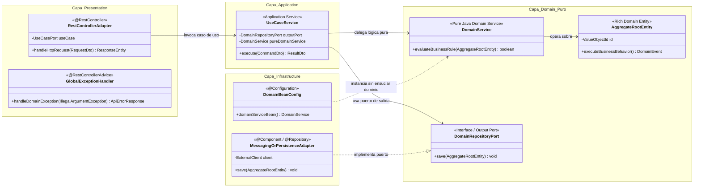
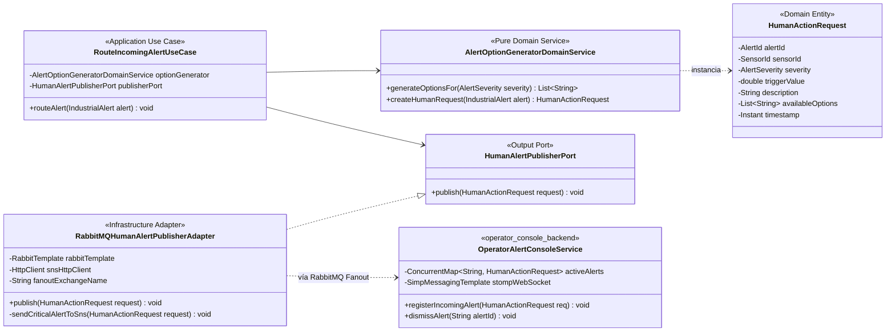
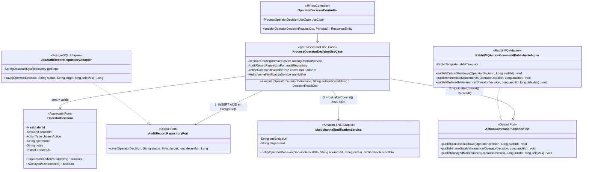

# 01. Diagramas de Clases UML — Plataforma de Mantenimiento Predictivo Interactivo

Para facilitar su lectura y sustentación académica, el modelo de clases UML se organiza en **4 vistas modulares** que reflejan la arquitectura limpia / hexagonal y los patrones de diseño orientados a objetos aplicados en los **8 microservicios Java 17 + Spring Boot 3.3.5**.

---

## Vista 1.1: Estructura Hexagonal Uniforme en los 8 Microservicios

Todos los microservicios respetan una separación estricta en **4 capas**, donde la capa `domain` es **100% Java puro** (sin anotaciones `@Service` ni dependencias de Spring, Kafka, RabbitMQ o JPA) y todas las dependencias se inyectan por constructor validando nulidad con `Objects.requireNonNull(...)`.

---

## Vista 1.2: Dominio Rico, Value Objects y Patrones `State` + `Strategy` (`alert_detector`)

Este módulo consume el flujo particionado de **Apache Kafka (`sensor_data`)**, mantiene una ventana móvil en memoria por cada sensor (`SensorStreamWindow`) y aplica:
1. **Patrón Strategy (`AnomalyDetectionStrategy`)**: Permite evaluar umbrales de la norma ISO 10816-3 (`> 75.0 mm/s` por 3 lecturas consecutivas o `> 90.0 mm/s` inmediato) o media móvil exponencial (`EMA`).
2. **Patrón State (`SensorOperationalState`)**: Controla las transiciones entre `NormalSensorState`, `WarningSensorState` y `CriticalSensorState`, emitiendo alertas **únicamente cuando cambia el estado** para evitar tormentas de alertas.

```mermaid
classDiagram
    direction TB

    class SensorId {
        <<ValueObject / Record>>
        -String value
        +SensorId(String value)
        +value() String
    }

    class AlertId {
        <<ValueObject / Record>>
        -String value
        +AlertId(String value)
        +generate()$ AlertId
        +value() String
    }

    class VibrationReadingRecord {
        <<ValueObject / Record>>
        -SensorId sensorId
        -double vibrationValue
        -Instant timestamp
        +exceedsThreshold(double limit) boolean
    }

    class IndustrialAlert {
        <<Domain Entity>>
        -AlertId alertId
        -SensorId sensorId
        -AlertSeverity severity
        -double triggerValue
        -String description
        -Instant detectedAt
    }

    class SensorStreamWindow {
        <<Stateful Aggregate Root>>
        -SensorId sensorId
        -Deque~VibrationReadingRecord~ window
        -int maxWindowSize
        -SensorOperationalState currentState
        +recordAndEvaluate(VibrationReadingRecord, AnomalyDetectionStrategy) Optional~IndustrialAlert~
        +consecutiveReadingsAbove(double threshold) int
        +resetToNormal() void
    }

    class SensorOperationalState {
        <<Interface / State Pattern>>
        +nextState(AlertSeverity evaluatedSeverity) SensorOperationalState
        +shouldEmitAlertOnTransitionTo(AlertSeverity next) boolean
        +severity() AlertSeverity
    }

    class NormalSensorState {
        +nextState(AlertSeverity evaluatedSeverity) SensorOperationalState
        +shouldEmitAlertOnTransitionTo(AlertSeverity next) boolean
        +severity() AlertSeverity
    }

    class WarningSensorState {
        +nextState(AlertSeverity evaluatedSeverity) SensorOperationalState
        +shouldEmitAlertOnTransitionTo(AlertSeverity next) boolean
        +severity() AlertSeverity
    }

    class CriticalSensorState {
        +nextState(AlertSeverity evaluatedSeverity) SensorOperationalState
        +shouldEmitAlertOnTransitionTo(AlertSeverity next) boolean
        +severity() AlertSeverity
    }

    class AnomalyDetectionStrategy {
        <<Interface / Strategy Pattern>>
        +evaluateSeverity(SensorStreamWindow window, VibrationReadingRecord latest) AlertSeverity
    }

    class ThresholdSlidingWindowStrategy {
        -double warningThreshold : 75.0
        -double criticalThreshold : 90.0
        -int requiredConsecutiveWarnings : 3
        +evaluateSeverity(SensorStreamWindow window, VibrationReadingRecord latest) AlertSeverity
    }

    class ExponentialMovingAverageStrategy {
        -double smoothingFactorAlpha : 0.35
        -double criticalThreshold : 90.0
        +evaluateSeverity(SensorStreamWindow window, VibrationReadingRecord latest) AlertSeverity
    }

    SensorStreamWindow *-- SensorId
    SensorStreamWindow *-- VibrationReadingRecord
    SensorStreamWindow --> SensorOperationalState : estado actual
    SensorOperationalState <|.. NormalSensorState
    SensorOperationalState <|.. WarningSensorState
    SensorOperationalState <|.. CriticalSensorState

    SensorStreamWindow ..> AnomalyDetectionStrategy : aplica estrategia
    AnomalyDetectionStrategy <|.. ThresholdSlidingWindowStrategy
    AnomalyDetectionStrategy <|.. ExponentialMovingAverageStrategy
    SensorStreamWindow ..> IndustrialAlert : genera en transición
```

---

## Vista 1.3: Enrutamiento de Alertas y Generación de Opciones (`alert_router` & `operator_console_backend`)

Consume las alertas desde los tópicos de Kafka (`alerts_warning` y `alerts_critical`), construye la solicitud de intervención humana (`HumanActionRequest`) con opciones dinámicas según la severidad y la publica en el **Fanout Exchange `human_alerts` de RabbitMQ** y hacia **Amazon SNS**.

---

## Vista 1.4: Despacho Transaccional ACID (`afterCommit`), RabbitMQ `x-delay` y Workers (`action_dispatcher`)

Garantiza que toda decisión tomada por el operador humano:
1. Tome el `operatorId` directamente del `Principal` autenticado en **Spring Security** (impidiendo suplantación).
2. Se guarde primero en **PostgreSQL (`operator_decision_audit`)** dentro de una transacción ACID.
3. Solo tras confirmarse el `COMMIT` en PostgreSQL (`TransactionSynchronization.afterCommit()`), publique el comando en **RabbitMQ** (`immediate_actions_exchange` o `delayed_actions_exchange` con cabecera `x-delay`) y despache el boletín corporativo **ISO 10816-3** vía **Amazon SNS**.

