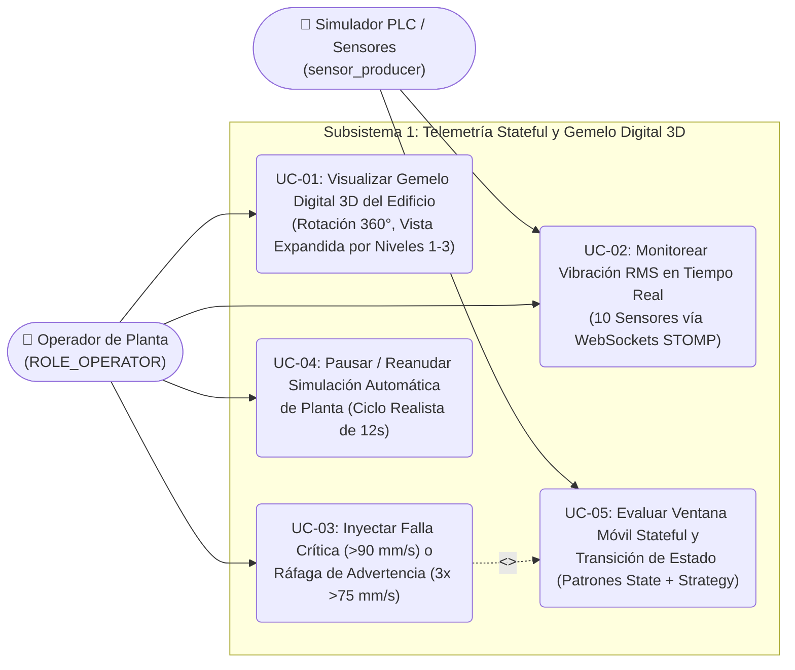
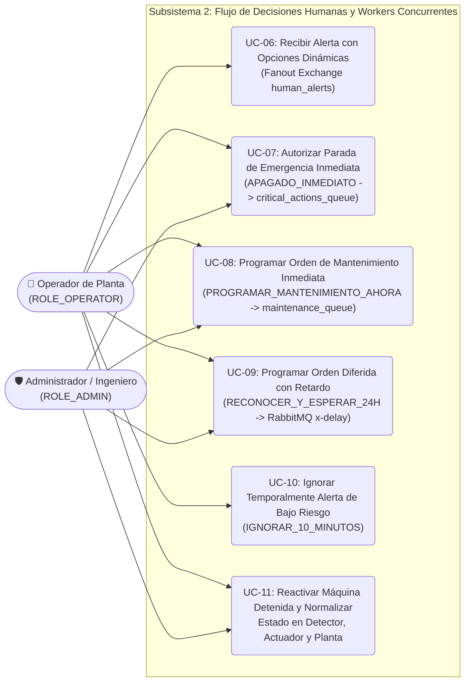
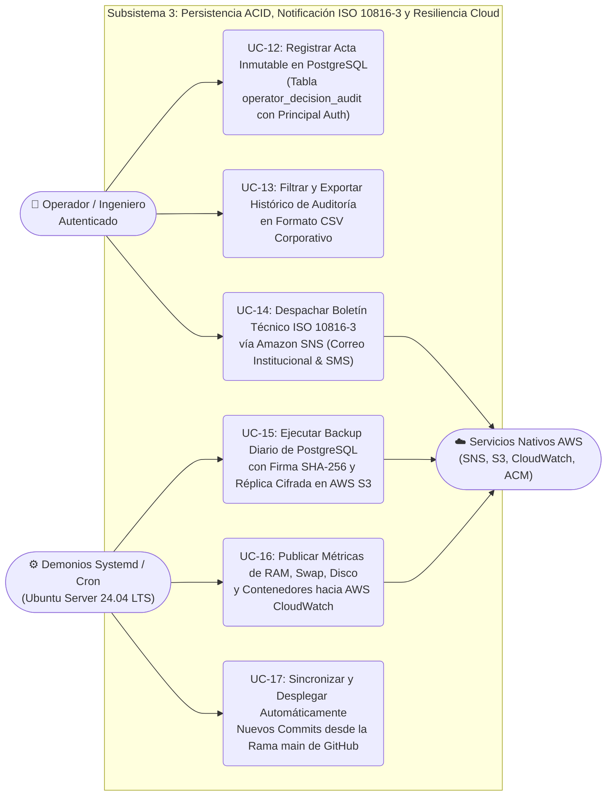

# 02. Diagramas de Casos de Uso UML — Plataforma de Mantenimiento Predictivo Interactivo

Para presentar con claridad todas las capacidades del sistema, los **Casos de Uso** se dividen en **3 Subsistemas Funcionales** según los actores que intervienen, acompañados de su matriz de trazabilidad hacia los microservicios.

---

## 1. Subsistema A: Monitoreo en Tiempo Real, Gemelo Digital 3D y Simulación (Apache Kafka)

---

## 2. Subsistema B: Toma de Decisiones, Enrutamiento Diferido y Actuación (RabbitMQ)

---

## 3. Subsistema C: Auditoría Transaccional ACID, Seguridad OS y Servicios AWS Cloud

---

## 4. Matriz de Trazabilidad de Casos de Uso vs. Microservicios

| Código | Caso de Uso | Microservicio / Componente Responsable | Tecnología Clave |
| :--- | :--- | :--- | :--- |
| **UC-01 / UC-02** | Gemelo Digital 3D y Telemetría en Vivo | `frontend_dashboard` + `plant_monitor_backend` | React 18, Canvas 3D, WebSocket STOMP |
| **UC-03 / UC-04** | Simulación Automática e Inyección de Fallas | `sensor_producer` | Apache Kafka (`sensor_data`, Key=`sensorId`) |
| **UC-05** | Detección Stateful en Ventana Móvil | `alert_detector` | Kafka Consumer + Patrones `State` y `Strategy` |
| **UC-06** | Generación de Opciones y Fanout | `alert_router` + `operator_console_backend` | RabbitMQ Fanout Exchange (`human_alerts`) |
| **UC-07** | Parada de Emergencia Inmediata | `action_dispatcher` $\rightarrow$ `actuator_worker` (x2) | RabbitMQ Direct (`critical_actions_queue`) |
| **UC-08 / UC-09** | Mantenimiento Inmediato y Diferido | `action_dispatcher` $\rightarrow$ `maintenance_worker` (x2) | Plugin `rabbitmq_delayed_message_exchange` (`x-delay`) |
| **UC-11** | Reactivación Integral de Máquina | `plant_monitor`, `alert_detector`, `actuator_worker` | Endpoints REST de Reset Coordinado |
| **UC-12 / UC-13** | Auditoría Transaccional Inmutable | `action_dispatcher` + `postgres` | PostgreSQL 16 ACID + Spring Security + `afterCommit` |
| **UC-14** | Boletín Corporativo ISO 10816-3 | `action_dispatcher`, `alert_router`, `scada-sns-bridge` | Amazon SNS (`us-east-2`) + Rol IAM `IMDSv2` |
| **UC-15 / UC-16 / UC-17** | Backups S3, CloudWatch y Auto-Deploy | Ubuntu Server 24.04 LTS (`hardening-ubuntu.sh`) | Amazon S3 (`AES256`), CloudWatch y Cron GitOps |
