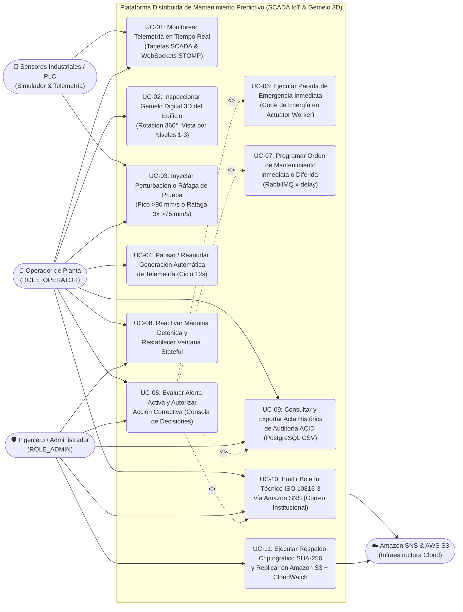

# Diagrama de Casos de Uso UML — Plataforma de Mantenimiento Predictivo Interactivo

Este documento detalla los **Actores** y **Casos de Uso** de la plataforma distribuida de Mantenimiento Predictivo Industrial desplegada en **AWS EC2**, abarcando tanto la operación humana en el **Gemelo Digital 3D** como los procesos autónomos de analítica en tiempo real y notificación en la nube con **Amazon SNS**.

---

## 1. Diagrama de Casos de Uso (Mermaid)

---

## 2. Especificación Detallada de Casos de Uso Principales

### UC-02: Inspeccionar Gemelo Digital 3D del Edificio Industrial
* **Actor Principal**: Operador de Planta (`ROLE_OPERATOR`) / Ingeniero de Confiabilidad (`ROLE_ADMIN`).
* **Precondiciones**: El servicio `plant_monitor_backend` está activo consumiendo el tópico `sensor_data` de Apache Kafka.
* **Flujo Principal**:
  1. El operador visualiza el edificio industrial de 3 niveles con sus 10 sensores distribuidos espacialmente (`sensor_A` a `sensor_J`).
  2. El operador rota el edificio en 360°, aplica zoom o activa la **Vista Expandida de Pisos 3D**.
  3. Cuando un sensor supera los umbrales de la norma ISO 10816-3 (`> 75 mm/s` por 3 lecturas o `> 90 mm/s`), el piso correspondiente se ilumina en ámbar o rojo y el nodo 3D emite ondas de choque y un haz vertical de alerta.
  4. El operador selecciona el nodo en el modelo 3D para abrir su **Inspector de Activo** con diagnóstico en vivo.

### UC-05: Evaluar Alerta Activa y Autorizar Acción Correctiva
* **Actor Principal**: Operador de Planta autenticado (`operator` o `admin`).
* **Precondiciones**: Existe una alerta pendiente en `operator_console_backend` proveniente del Fanout Exchange `human_alerts` de RabbitMQ.
* **Flujo Principal**:
  1. El operador revisa la alerta en la consola derecha junto con las opciones dinámicas generadas por `alert_router`.
  2. El operador ingresa una observación técnica para el acta y selecciona una maniobra (`APAGADO_INMEDIATO`, `PROGRAMAR_MANTENIMIENTO_AHORA`, `RECONOCER_Y_ESPERAR_24H` o `IGNORAR_10_MINUTOS`).
  3. `action_dispatcher` valida las credenciales vía HTTP Basic Auth y extrae el usuario autenticado desde el `Principal` de Spring Security (impidiendo suplantación de identidad).
  4. Se persiste el registro inmutable en la tabla `operator_decision_audit` de PostgreSQL dentro de una transacción ACID.
  5. Una vez confirmado el `COMMIT` en PostgreSQL (`afterCommit`), `action_dispatcher` publica el comando en RabbitMQ (`immediate_actions_exchange` o `delayed_actions_exchange` con cabecera `x-delay: 10000`) y despacha el **Boletín Corporativo ISO 10816-3** vía **Amazon SNS**.
  6. La alerta resuelta se elimina automáticamente de la consola de alertas pendientes.
