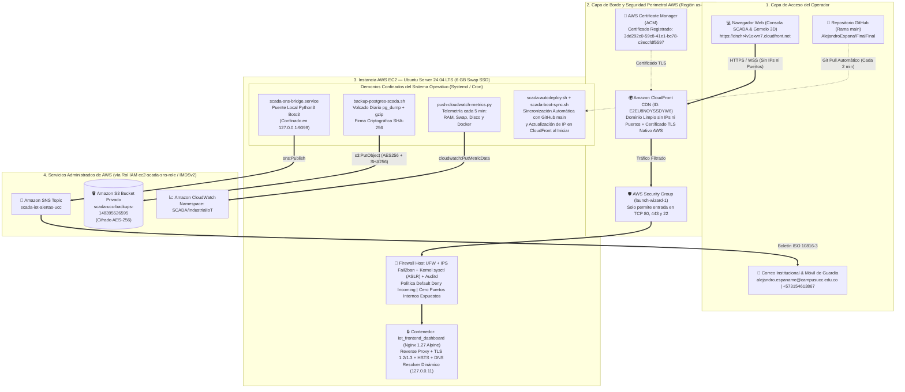
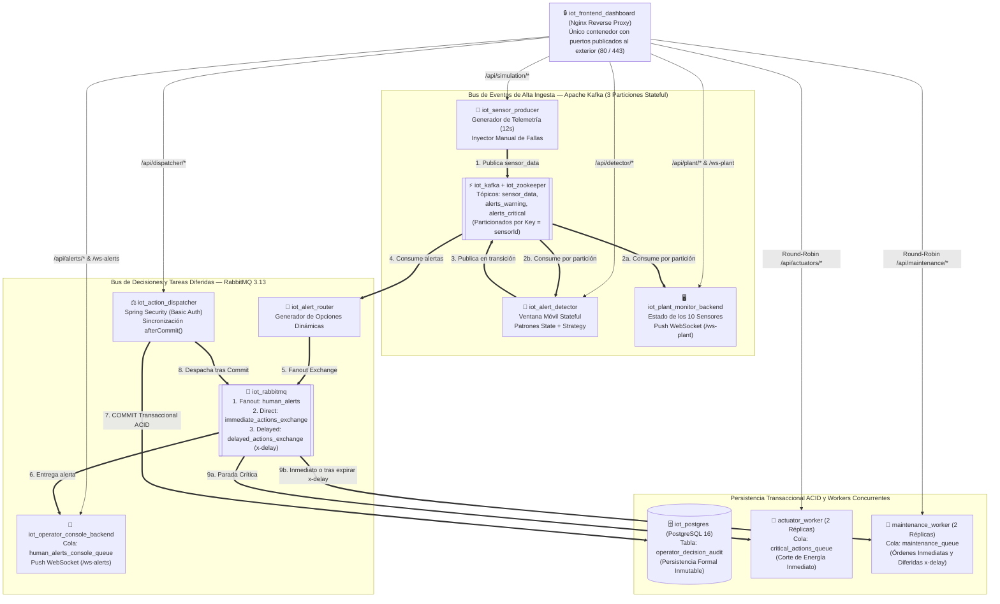

# 03. Diagramas de Despliegue UML — Arquitectura Cloud en AWS con Defensa en Profundidad

El despliegue en producción se divide en **2 diagramas complementarios** para facilitar su lectura:
1. **Topología Perimetral, Seguridad de Sistema Operativo Ubuntu 24.04 LTS y Servicios Cloud AWS**.
2. **Topología Interna de Contenedores Docker, Buses de Mensajería (Kafka y RabbitMQ) y Persistencia (PostgreSQL)**.

---

## 1. Vista Externa: Red de Borde AWS CloudFront, Hardening Ubuntu Server y Servicios Cloud

---

## 2. Vista Interna: Red Privada Docker (`iot_industrial_net` — Confinada en `127.0.0.1`)

Todos los microservicios y motores de datos corren dentro de la red bridge aislada `iot_industrial_net` con usuarios sin privilegios (`appuser`) y límites estrictos de CPU y memoria RAM.

