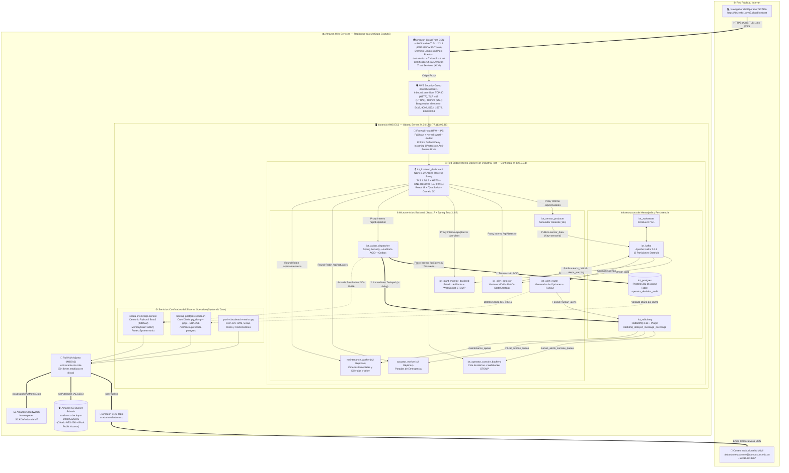

# Diagrama de Despliegue UML — Infraestructura Cloud en AWS EC2 con Defensa en Profundidad

Este documento describe la arquitectura física y lógica de despliegue en **Amazon Web Services (AWS — Región `us-east-2` Ohio)** sobre una instancia **Ubuntu Server 24.04 LTS**, integrando el blindaje de Sistemas Operativos (Hardening), aislamiento de puertos en `127.0.0.1`, cifrado TLS 1.2/1.3 y servicios nativos de AWS (**Amazon SNS**, **Amazon S3** y **Amazon CloudWatch**).

---

## 1. Diagrama de Despliegue en Producción (Mermaid)

---

## 2. Tabla de Componentes de Despliegue y Confinamiento de Red

| Componente / Servicio | Contenedor / Unidad | Exposición Pública | Red / Mecanismo de Acceso | Límite de Recursos |
| :--- | :--- | :--- | :--- | :--- |
| **Reverse Proxy & SPA 3D** | `iot_frontend_dashboard` | **Sí** (`HTTP` / `HTTPS`) | Único punto de entrada público con TLS 1.2/1.3, HSTS y Rate Limiting | `0.25 vCPU` / `128 MB` |
| **PostgreSQL 16** | `iot_postgres` | **No** (Confinado) | Red interna `iot_industrial_net` + Loopback `127.0.0.1` | `0.50 vCPU` / `512 MB` |
| **Apache Kafka + Zookeeper** | `iot_kafka`, `iot_zookeeper` | **No** (Confinado) | Red interna `iot_industrial_net` (3 particiones por `sensorId`) | `1.50 vCPU` / `1280 MB` |
| **RabbitMQ 3.13 + Delayed** | `iot_rabbitmq` | **No** (Confinado) | Red interna `iot_industrial_net` (credenciales personalizadas) | `0.50 vCPU` / `512 MB` |
| **8 Microservicios Spring Boot** | `iot_*` + réplicas workers | **No** (Confinado) | Accesibles únicamente desde Nginx vía DNS interno `127.0.0.11` | `0.50 vCPU` / `384-512 MB` c/u |
| **Puente Amazon SNS** | `scada-sns-bridge.service` | **No** (Confinado) | Servicio `systemd` local con `ProtectSystem=strict` + Rol IAM `IMDSv2` | `0.50 vCPU` / `128 MB` |
| **Respaldo Criptográfico** | `backup-postgres-scada.sh` | **No** (Local + S3) | Cron diario con `gzip -9`, firma `SHA-256` y subida cifrada a AWS S3 | Ejecución programada |
