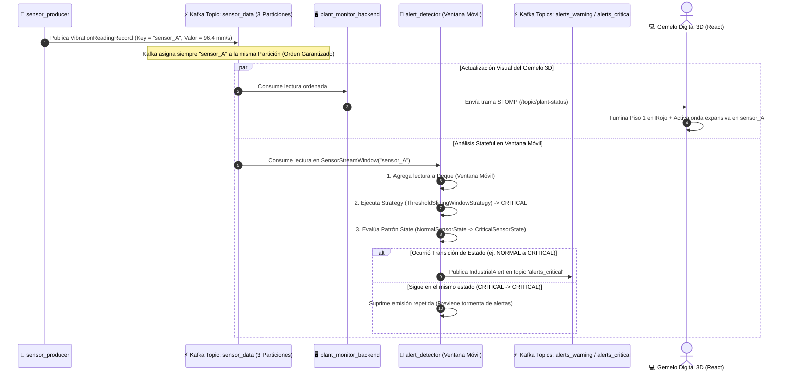
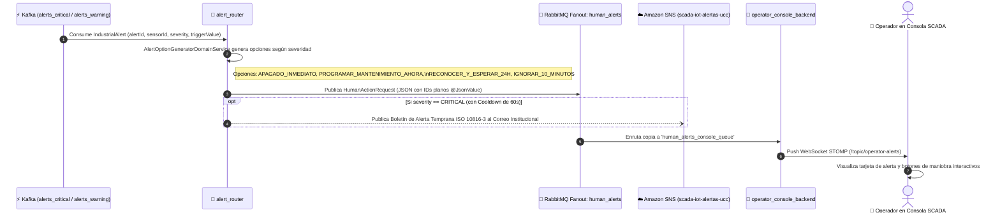
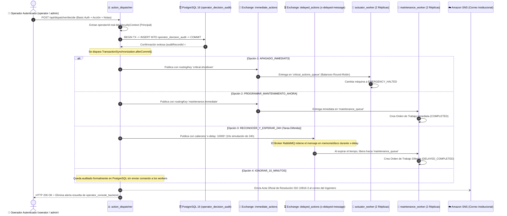

# 04. Diagramas de Procesos y Secuencia — Flujo de Datos, Decisiones y Auditoría

Para explicar con total claridad el funcionamiento de punta a punta, los procesos se dividen en **3 secuencias especializadas** que corresponden exactamente a los objetivos de aprendizaje del caso de estudio.

---

## 1. Proceso A: Flujo de Datos Masivos y Detección Stateful en Apache Kafka

Demuestra cómo se garantiza el **orden cronológico estricto por sensor** utilizando `sensorId` como **Key de particionamiento en Kafka** y cómo los patrones **Strategy** y **State** evitan la tormenta de alertas.

---

## 2. Proceso B: Enrutamiento de Alertas y Generación de Opciones (`alert_router` + RabbitMQ Fanout)

Demuestra el puente entre el bus analítico (**Apache Kafka**) y el bus de decisiones operativas (**RabbitMQ**), enriqueciendo la alerta con opciones de acción para el humano.

---

## 3. Proceso C: Decisión Humana, Auditoría ACID (`afterCommit`), Retardo `x-delay` y Ejecución en Workers

Demuestra la **consistencia transaccional** entre PostgreSQL y RabbitMQ, el funcionamiento del plugin **`rabbitmq_delayed_message_exchange`** y la distribución de carga entre las **2 réplicas** de cada worker.

