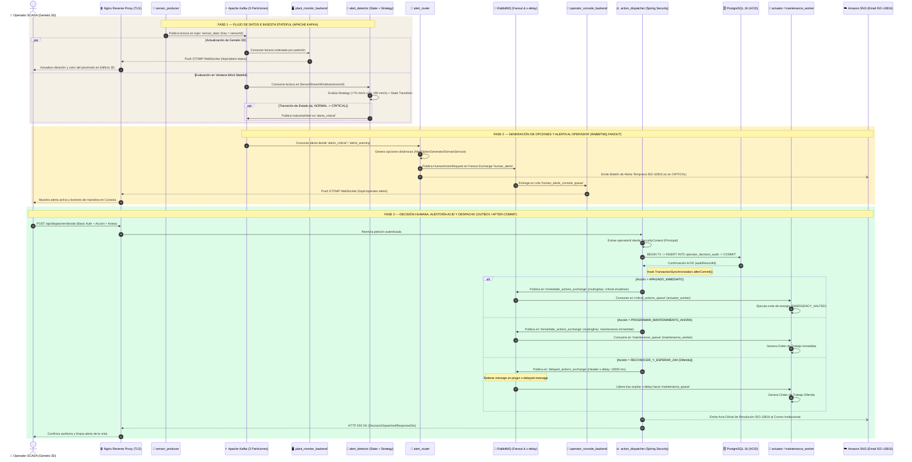
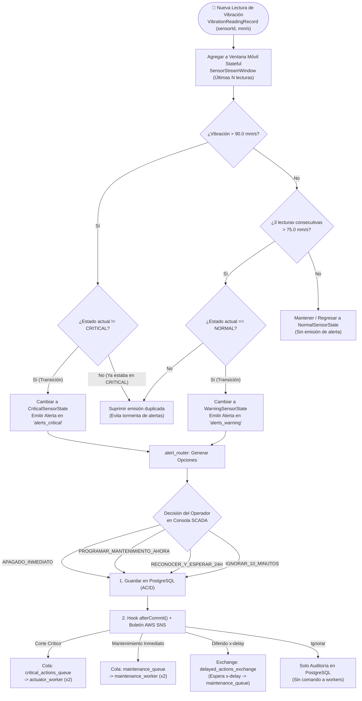

# Diagramas de Procesos y Secuencia — Flujo de Datos, Flujo de Decisiones y Auditoría ACID

Este documento presenta los **Diagramas de Procesos y Secuencia** de punta a punta de la plataforma, mostrando cómo interactúan el **Flujo de Datos Masivos (Apache Kafka)**, el **Flujo de Decisiones y Tareas Diferidas (RabbitMQ)**, la **Persistencia Transaccional (PostgreSQL)**, el **Gemelo Digital 3D** y la **Notificación Cloud (Amazon SNS + Amazon S3)**.

---

## 1. Diagrama de Secuencia E2E: Ingesta, Detección Stateful, Decisión Humana y Despacho

---

## 2. Diagrama de Proceso: Máquina de Estados del Sensor y Reglas deEnrutamiento

